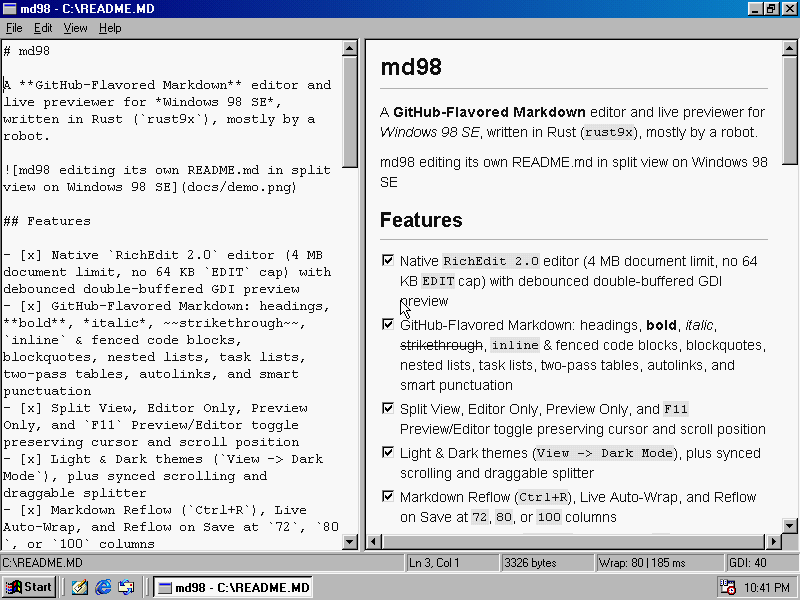

# md98

A **GitHub-Flavored Markdown** editor and live previewer for *Windows 98 SE*, written in Rust (`rust9x`), mostly by a robot.



## Features

- [x] Native `RichEdit 2.0` editor (4 MB document limit, no 64 KB `EDIT` cap) with debounced double-buffered GDI preview
- [x] GitHub-Flavored Markdown: headings, **bold**, *italic*, ~~strikethrough~~, `inline` & fenced code blocks, blockquotes, nested lists, task lists, two-pass tables, autolinks, and smart punctuation
- [x] Split View, Editor Only, Preview Only, and `F11` Preview/Editor toggle preserving cursor and scroll position
- [x] Light & Dark themes (`View -> Dark Mode`), plus synced scrolling and draggable splitter
- [x] Markdown Reflow (`Ctrl+R`), Live Auto-Wrap, and Reflow on Save at `72`, `80`, or `100` columns
- [x] Native Win98 Find (`Ctrl+F`), Find Next (`F3`), and Replace (`Ctrl+H`) dialogs
- [x] Persistent preferences stored in `HKCU\Software\md98` and unsaved-changes confirmation prompts

## Target Hardware & Specs

| Spec | Target |
| :--- | :--- |
| **OS** | Windows 98 Second Edition (4.10.2222 A), PE32 Subsystem 4.0 |
| **CPU** | Intel Pentium (`i586`) or newer (no `CMOV`/`NOPL`/MMX/SSE/SSE2) |
| **RAM** | 40 MB total (< 4 MB working set) |
| **Display** | 800x600 @ 16-bit color, cached GDI objects (zero handle leaks) |
| **DLLs** | Stock Win98 SE ANSI (`*A`) DLLs only — zero `unicows.dll` |
| **Binary** | ~280 KB standalone `md98.exe` |

## Keyboard Shortcuts

| Shortcut | Action |
| :--- | :--- |
| `Ctrl+N` / `Ctrl+O` / `Ctrl+S` | New / Open / Save |
| `Ctrl+Q` | Exit (prompts if modified) |
| `Ctrl+Z` / `X` / `C` / `V` / `A` | Undo / Cut / Copy / Paste / Select All |
| `Ctrl+F` / `F3` / `Ctrl+H` | Find / Find Next / Replace |
| `Ctrl+R` | Reflow selection or document to configured column width |
| `F11` | Toggle between Preview Only and Editor Only |

## Preferences & CLI Options

Preferences are saved automatically under `HKEY_CURRENT_USER\Software\md98` (`ViewMode`, `DarkMode`, `SyncScroll`, `WrapWidth`, `LiveWrap`, `ReflowOnSave`, and `SplitPos`).

Command-line flags override stored preferences for the current session:

```text
md98.exe [file.md] [--dark-mode] [--wrap-width 72|80|100] [--live-wrap] [--reflow-on-save]
```

## Architecture

- [`crates/md98-core`](crates/md98-core) — Platform-independent GFM parser (`pulldown-cmark`), integer-only arena layout engine behind a `TextMeasurer` trait, CP1252 ↔ UTF-8 transcoder, Markdown reflow/live-wrap engine, and search/replace logic.
- [`crates/md98-win32`](crates/md98-win32) — Minimal Win32 ANSI (`*A`) SDI shell (`KERNEL32`, `USER32`, `GDI32`, `ADVAPI32`, `COMDLG32`, `COMCTL32`, `RICHED20`), cached GDI resources, viewport-sized double buffer, and Registry preference storage.
- [`infra/`](infra) — Podman/Docker `rust9x` cross-compilation container, static PE32/Win98 SE export & `i586` ISA auditor (`audit_pe.py`), and headless QEMU/QMP/COM1 Windows 98 SE verification harness.

## Building & Testing

```bash
# Run platform-independent core unit tests on the host
cargo test -p md98-core

# Cross-compile dist/md98.exe (i586-rust9x-windows-msvc) and run static PE32 + ISA audit
./scripts/build_win98.sh md98-win32 md98
```

## License

MIT — see [LICENSE](LICENSE).
